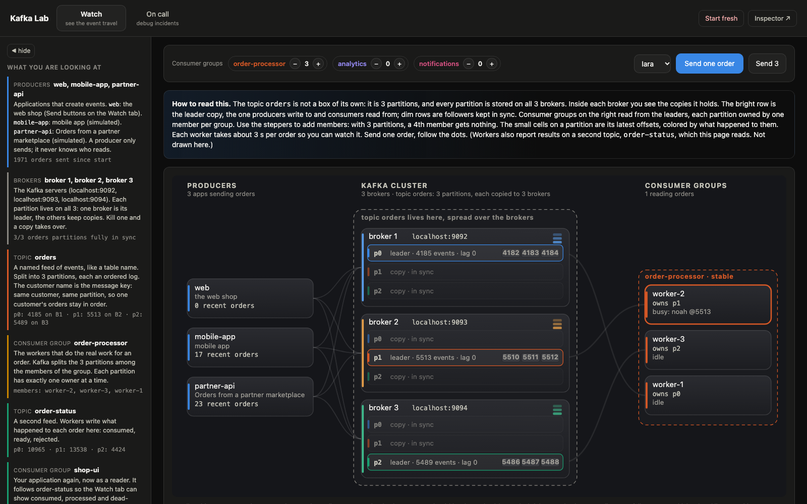
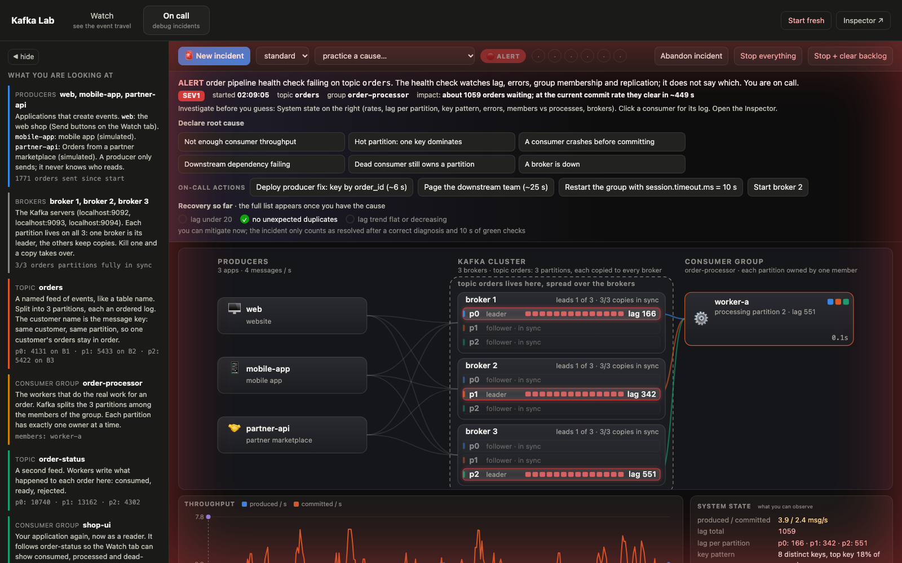

# Kafka Lab

An order-processing service on a real 3-broker Kafka cluster, a UI that shows what the
broker is doing, and an on-call game that breaks the system and makes you find the cause.

Nothing is simulated. Every number on screen is read from the broker.

**Watch**: producers, the three brokers with every partition replica, and the consumer group. Events animate along the edges.



**On call**: the lab broke something and does not say what. Lag is climbing. Find the cause.



## Run

Requires Docker and Python 3.11+.

```bash
python -m venv .venv && source .venv/bin/activate
make up       # 3 Kafka brokers (KRaft), Kafka UI, kafka-exporter, Prometheus, Grafana
make setup    # pip install + create topics
make lab      # shop (8000) and inspector (8080) in the background
make stop-lab
```

Open http://localhost:8000.

| URL | What |
|---|---|
| http://localhost:8000 | Lab: Watch and On call tabs |
| http://localhost:8080 | Inspector: partitions, offsets, lag, group members, message tail |
| http://localhost:8081 | Kafka UI |
| http://localhost:3000 | Grafana, dashboard "Kafka Lab Overview" |
| http://localhost:9090 | Prometheus |

## Tabs

- **Watch**: live topology. Producers, brokers with partition replicas, consumer groups. Events animate along the edges. Add or remove consumers and see partitions get reassigned.
- **On call**: press *New incident*. The lab breaks something and does not tell you what. Investigate, declare the root cause, apply a fix, wait for the checks to hold. Full guide in [docs/ONCALL.md](docs/ONCALL.md).

## Incidents

| Cause | Lesson |
|---|---|
| [Lag storm](docs/scenarios/01-lag-storm.md) | lag, consumer parallelism, partitions as the ceiling |
| [Hot partition](docs/scenarios/02-hot-partition.md) | keys choose partitions, skew |
| [Crash before commit](docs/scenarios/03-crash-before-commit.md) | offsets, at-least-once, duplicates |
| [Poison messages](docs/scenarios/04-poison-messages.md) | retries, backoff, dead-letter topic |
| [Zombie worker](docs/scenarios/05-zombie-worker.md) | heartbeats, session timeout |
| [Broker down](docs/scenarios/06-broker-down.md) | replication, leader election, ISR |

## CLI

```bash
make topics                                 # kafka-topics --describe
make groups                                 # kafka-consumer-groups --list
make describe-group GROUP=order-processor   # committed offset, log end, lag, owner per partition
make tail-orders                            # kafka-console-consumer with key, partition, offset
make reset-group GROUP=order-processor      # rewind to earliest; stop its workers first
make stop-broker N=2 / make start-broker N=2
make logs                                   # broker log
make worker NAME=w1 DELAY=0.5               # a consumer from the terminal
```

Raw form, inside a broker container:

```bash
docker exec kafka-1 kafka-consumer-groups --bootstrap-server kafka-1:29092 \
  --describe --group order-processor
```

## Load

```bash
python scripts/loadgen.py --rate 5000 --seconds 30
python scripts/loadgen.py --rate 20000 --processes 4
```

## How it is built

- Topics: `orders` (3 partitions), `order-status` (3), `orders.dlq` (1). Replication factor 3, `min.insync.replicas=1`, auto-create off.
- Producers `web`, `mobile-app`, `partner-api`. Key is the customer, so one customer's orders stay in order.
- Consumer group `order-processor` does the work: manual commit after processing, retries with backoff, dead-letter topic. Groups `analytics` and `notifications` read the same topic independently.
- Lifecycle shown in the UI: *produced* from the broker ack, *consumed* and *processed* from events the worker publishes, *committed* from the group's committed offset.
- Inspector is read-only. Admin API for metadata and offsets, `assign()` consumers for watermarks and tailing, no commits.
- Clients connect to `localhost:9092,9093,9094`. Containers use `kafka-N:29092`.

## Layout

```
services/shop/app.py            FastAPI: orders, generator, workers, incidents, /metrics
services/shop/static/           lab.html, graph.html, index.html
services/processor/worker.py    the consumer
services/inspector/             admin-API collector, tailer, /metrics
scripts/create_topics.py        topic setup
scripts/loadgen.py              producer load generator
ops/                            Prometheus and Grafana config
docs/LEARN.md                   8 short lessons, start here if Kafka is new
docs/ONCALL.md                  the On call tab explained
docs/scenarios/                 one write-up per incident
```
